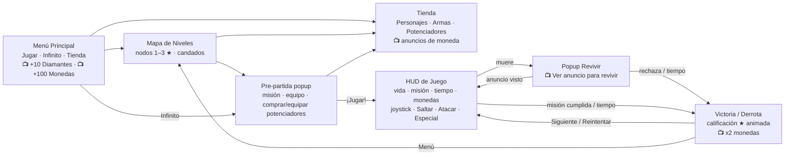

# Arcade Blaster 2D — Plantilla Run & Gun hipercasual (Unity, marca blanca)

Plantilla de videojuego móvil 2D de acción arcade (Run & Gun / Action RPG ligero) con:

- **Modo Niveles** (mapa de progresión, calificación 1–3 ★) y **Modo Infinito** (dificultad creciente y récords).
- **Controles táctiles**: joystick virtual a la izquierda y botones **Saltar / Atacar / Especial** a la derecha.
- Partidas de **2–3 minutos** con misión visible en pantalla: *Elimina a 30 enemigos*, *Sobrevive*, *Derrota al Jefe*.
- **Economía dual** (Monedas / Diamantes), tienda de personajes, mejoras de armas (**Damage** y **Attack Delay**) y potenciadores.
- **Monetización solo con anuncios recompensados** (AdMob o Unity Ads), conectada a botones listos para usar.
- **Arquitectura de marca blanca**: la lógica no referencia ningún sprite ni sonido. Para revender el juego a otro cliente se cambia un único asset (`SkinProfile`).

> Motor: **Unity 6 LTS** (compatible con 2021.3 / 2022.3 LTS). Lenguaje: C#. Sin dependencias de pago.

---

## 1. Puesta en marcha (≈ 5 minutos)

1. En Unity Hub: **Add project from disk** → selecciona la carpeta `ArcadeRunGun2D/`
   (o crea un proyecto *2D (URP o Built-in)* nuevo y copia dentro `Assets/_Game`).
2. Importa TextMeshPro: **Window → TextMeshPro → Import TMP Essential Resources**.
3. Ejecuta **Tools → HyperArcade → 1. Crear contenido por defecto (todo)**. El asistente genera:
   - capas físicas (`Ground`, `Player`, `Enemy`, `Pickup`, `Projectile`),
   - arte y sonidos de **prueba** (formas cartoon y bips sintetizados) y el skin por defecto,
   - 3 personajes, 3 armas, 5 enemigos (incl. jefe), 3 potenciadores, 9 niveles y la configuración del Modo Infinito,
   - los prefabs genéricos y las escenas **MainMenu** y **Game** con toda la UI conectada.
4. **Player Settings → Resolution and Presentation → Orientation: Landscape Left**.
5. Pulsa **Play** en `MainMenu`. En el editor puedes usar teclado: `A/D` mover, `W` apuntar arriba, `Espacio` saltar, `J` atacar, `K` especial, `Esc` atrás/pausa.

Los anuncios en el editor son simulados (`MockAdsProvider`): duran 1,5 s y siempre recompensan.

---

## 2. Flujo de pantallas



| Pantalla | Script | Escena |
|---|---|---|
| Menú principal | `UI/Menu/MainMenuScreen.cs` | MainMenu |
| Mapa de niveles + nodo | `UI/Menu/LevelMapScreen.cs`, `LevelNodeUI.cs` | MainMenu |
| Tienda (personajes / armas / potenciadores) | `UI/Shop/ShopController.cs`, `ShopItemUI.cs` | MainMenu |
| Tienda pre-partida | `UI/Menu/PreMatchPopup.cs`, `ConsumableSlotUI.cs` | MainMenu |
| Navegación + botón Atrás de Android | `UI/Common/UIScreenManager.cs`, `UIScreen.cs` | MainMenu |
| HUD de juego | `UI/Game/HUDController.cs`, `PowerUpButtonUI.cs` | Game |
| Revivir / Pausa | `UI/Game/RevivePopup.cs`, `PausePopup.cs` | Game |
| Victoria / Derrota con calificación | `UI/Game/ResultPopup.cs`, `UI/Common/StarsDisplay.cs` | Game |

---

## 3. Arquitectura

```
Assets/_Game/
├── Scripts/
│   ├── Core/        GameConfig (raíz de config), GameSession (menú→juego), GameEvents (bus de eventos),
│   │                Systems (arranque automático), PoolManager, Texts (todos los textos visibles), Enums
│   ├── Data/        ScriptableObjects SOLO de lógica: CharacterData, WeaponData, EnemyData, LevelData,
│   │                ConsumableData, EconomyConfig, EndlessConfig, AdsConfig
│   ├── Save/        SaveData (modelo) + SaveSystem (JSON con respaldo y hash; PlayerPrefs en WebGL)
│   ├── Economy/     Wallet (monedas/diamantes), PlayerProgress (inventario/progreso), ShopService (reglas de compra),
│   │                Coin, CoinDropper
│   ├── Input/       VirtualJoystick, TouchActionButton, PlayerInputHub (táctil + teclado), InputUtil
│   ├── Player/      PlayerController (movimiento), PlayerHealth (vida/escudo/revivir), PlayerCombat
│   ├── Combat/      WeaponController (disparo + especial), Projectile, IDamageable
│   ├── Enemies/     EnemyController (IA Walker/Flyer/Shooter/Boss), EnemySpawner (oleadas), EndlessDirector, EnemyRegistry
│   ├── Gameplay/    MatchController (director de partida), MissionTracker, PowerUpController, CameraFollow2D, KillZone
│   ├── Ads/         IAdsProvider, AdsManager, MockAdsProvider, AdMobProvider, UnityAdsProvider, RewardedAdButton
│   ├── Skin/        SkinProfile (TODO el arte/sonido), SkinManager (búsqueda con respaldo), SkinnedVisual,
│   │                SkinnedUIImage/Color/Text/Font, EnvironmentBuilder (fondos parallax + suelo)
│   ├── Audio/       AudioManager (pide clips al skin por ID)
│   ├── UI/          Common / Menu / Shop / Game
│   └── Editor/      HyperArcadeSetup (asistente), ReskinTools (marca blanca), PlaceholderArt, EditorUIBuilder
├── Skins/Default/   Skin_Default.asset + Sprites/ + Audio/      ← lo único que cambia entre clientes
├── Data/            assets de personajes, armas, enemigos, niveles, consumibles y configs
├── Prefabs/         Player, Enemy, Projectile, Coin (genéricos, sin arte) + UI/
├── Resources/       GameConfig.asset
└── Scenes/          MainMenu.unity, Game.unity
```

**Principios**

- **Lógica ≠ arte.** Los datos usan *claves* (`visualKey = "enemy_grunt"`), y `SkinManager` las resuelve en el `SkinProfile` activo. Un único prefab de enemigo sirve para todos los tipos.
- **Sin escena de arranque.** `Systems` se crea solo (`RuntimeInitializeOnLoadMethod`) con guardado, audio, anuncios y toasts: cualquier escena se prueba con Play.
- **Eventos desacoplados.** Enemigos, jugador y economía publican en `GameEvents`; HUD, misiones y audio se suscriben.
- **Pooling** de proyectiles, enemigos y monedas para evitar picos de GC en móvil.
- **Un archivo por MonoBehaviour** (requisito de Unity) y comentarios en español.

---

## 4. Jugabilidad

| Elemento | Detalle |
|---|---|
| Movimiento | Aceleración suave, *coyote time*, *buffer* de salto, salto variable, doble/triple salto según personaje, plataformas de un sentido |
| Ataque básico | Mantener **Atacar**. Cadencia = *Attack Delay* del arma. Auto-apuntado suave al enemigo más cercano en ±35° |
| Especial | Botón **Especial** con cooldown radial: abanico de 7 (Blaster), Nova de 16 (Escopeta), rayo perforante (Láser) |
| Enemigos | Walker, Flyer, Shooter y Boss (fases persecución/ráfaga, se enfurece al 50 %). Sueltan monedas que vuelan solas al jugador |
| Misiones | `KillEnemies`, `Survive`, `DefeatBoss`, con límite de tiempo (120–180 s) |
| Estrellas | 1★ completar · 2★ terminar con ≥ 40 % de vida · 3★ ≥ 75 % de vida y antes del 75 % del tiempo (configurable por nivel) |
| Progresión | Cada nivel se desbloquea con 1★ en el anterior |
| Modo Infinito | Intervalo de aparición, enemigos simultáneos, vida (+25 %/min) y velocidad aumentan; jefe cada 90 s; puntuación = bajas·10 + segundos + jefes·500 |

Ajusta todo desde los assets de `Data/` sin tocar código.

---

## 5. Economía, tienda y guardado

| Ítem | Precio por defecto | Efecto |
|---|---|---|
| Kira (personaje) | 2 000 🪙 | Rápida, triple salto, 80 HP |
| Bruno (personaje) | 80 💎 | 160 HP, daño ×1,25 |
| Escopeta / Láser | 1 500 🪙 / 60 💎 | Otra forma de disparo y otro especial |
| Mejora Damage / Attack Delay | 100 🪙 × 1,45ⁿ | +daño por nivel / −tiempo entre disparos (hasta 10 niveles) |
| x2 Monedas | 250 🪙 | Duplica las monedas de toda la partida |
| Escudo | 150 🪙 | 6 s de invulnerabilidad (botón en el HUD) |
| Convertidor | 5 💎 | Convierte a los enemigos en pantalla en monedas |

- Los botones de compra nunca se bloquean: si falta saldo se muestra *"¡Mira un anuncio para conseguir más!"* y el botón de anuncio palpita.
- Las monedas de la partida **se guardan también al perder** (mejor retención).

**Guardado** (`Save/SaveSystem.cs`): JSON en `Application.persistentDataPath/save.json` + copia `save.bak`, escritura atómica, hash SHA-256 con sal (anti-edición) y migración por versión. En WebGL se usa `PlayerPrefs`. Ejemplo del contenido (`SaveData`):

```json
{
  "version": 1, "coins": 1350, "diamonds": 25,
  "selectedCharacterId": "hero", "unlockedCharacters": ["hero", "ninja"],
  "selectedWeaponId": "blaster",
  "weapons": [{ "weaponId": "blaster", "unlocked": true, "damageLevel": 3, "delayLevel": 2 }],
  "consumables": [{ "id": "Shield", "count": 2 }],
  "levels": [{ "levelId": "level_01", "stars": 3, "bestCoins": 96 }],
  "endlessBestScore": 4210, "endlessBestTime": 212.5, "totalMatches": 14,
  "ads": { "day": "2026-10-21", "watchedToday": [{ "id": "diamonds", "count": 2 }], "totalWatched": 31 },
  "settings": { "musicVolume": 0.7, "sfxVolume": 1.0, "vibration": true }
}
```

---

## 6. Monetización (anuncios recompensados)

| Ubicación (`AdPlacement`) | Dónde | Recompensa | Límite |
|---|---|---|---|
| `MenuDiamonds` / `ShopDiamonds` | Menú y Tienda | +10 💎 | 5/día compartidos, 60 s entre anuncios |
| `MenuCoins` / `ShopCoins` | Menú y Tienda | +100 🪙 | 10/día compartidos, 60 s entre anuncios |
| `Revive` | Al morir (cuenta atrás de 6 s) | Revivir con 100 % de vida, 2,5 s de invulnerabilidad | 1 por partida |
| `DoubleCoins` | Pantalla de victoria / fin de Infinito | Suma otra vez las monedas obtenidas | 1 por partida |

Todos los valores están en `Data/Config/EconomyConfig.asset`. Guía completa de integración de **AdMob** y **Unity Ads**: [`docs/MONETIZACION.md`](docs/MONETIZACION.md).

---

## 7. Marca blanca / reskin en menos de 1 hora

Resumen (guía detallada con tiempos en [`docs/GUIA_RESKIN.md`](docs/GUIA_RESKIN.md)):

1. **Tools → HyperArcade → 3. Crear skin de cliente (plantilla)** → crea `Skin_<Cliente>.asset`, carpetas y `LEEME_RECURSOS.txt` con todas las claves.
2. Arrastra los sprites del protagonista, enemigos, fondo, logo y sonidos a sus ranuras. **Lo que dejes vacío se hereda del skin por defecto**, así que puedes cambiar solo el protagonista y el logo.
3. Edita título, empresa, eslogan y colores en el mismo asset.
4. **Tools → HyperArcade → 2. Validar skin activo**.
5. Player Settings (nombre, paquete, icono) + IDs de anuncios del cliente en `AdsConfig` → compilar.

---

## 8. Cómo extender

- **Nuevo enemigo:** *Create → HyperArcade → Enemy*, elige comportamiento y estadísticas, añade su `VisualSet` (misma `visualKey`) al skin y úsalo en las oleadas de un `LevelData`.
- **Nuevo nivel:** *Create → HyperArcade → Level* y añádelo a `GameConfig.levels` (el orden de la lista es el orden del mapa).
- **Nuevo personaje o arma:** *Create → HyperArcade → Character / Weapon* y añádelo a `GameConfig`. La tienda lo muestra sola.
- **Otra red de anuncios (AppLovin, LevelPlay…):** implementa `IAdsProvider` y regístrala en `AdsManager.CreateProvider`.
- **Traducción:** todos los textos están en `Core/Texts.cs`.

---

## 9. Estado de verificación

- Todo el código (runtime + editor) se compiló con el SDK de .NET contra los ensamblados de referencia de UnityEngine/UnityEditor, en 5 combinaciones de símbolos: Input Manager clásico y nuevo Input System, editor y dispositivo, y con `HA_ADMOB` + `HA_UNITY_ADS` activados (las APIs de los SDK de anuncios y de uGUI/TextMeshPro se verificaron contra *stubs* mínimos).
- **No se ha ejecutado dentro del Editor de Unity** en este entorno: la primera ejecución del asistente y una partida de prueba en un dispositivo son el siguiente paso recomendado. Si algo no encaja, el asistente se puede volver a ejecutar cuando quieras (sobrescribe el contenido generado).
- `Handheld.Vibrate()` solo existe al compilar para Android/iOS (por eso está protegido con `#if`).
